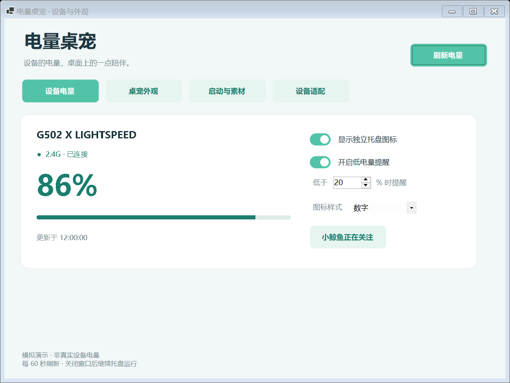
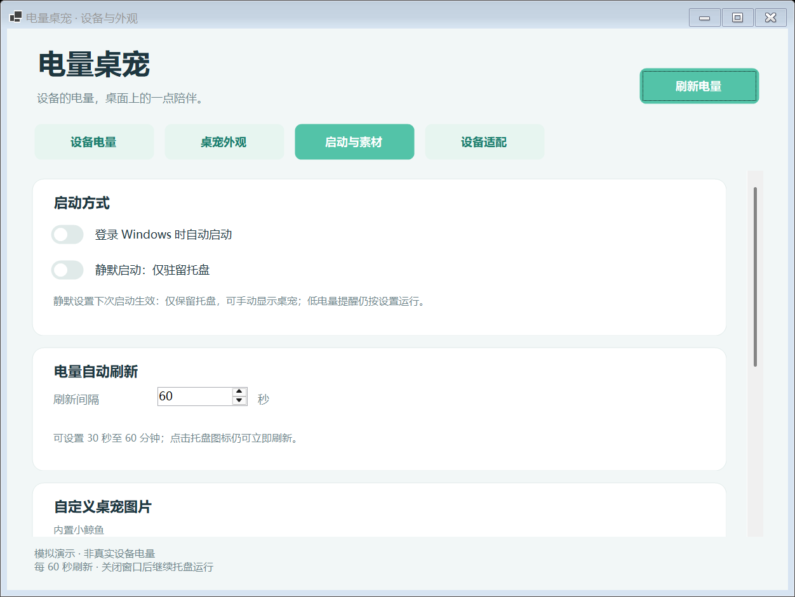

<div align="center">

# BatteryPet

**Your peripheral battery, a little company on your desktop.**

Windows tray battery monitor · Interactive desktop pet · Agent-assisted adapters

[简体中文](README.zh-CN.md) · [Download](https://github.com/sadwind227/BatteryPet/releases) · [What's new](CHANGELOG.md) · [User guide](docs/USER_GUIDE.zh-CN.md)

**v0.7.0-dev · Preview · Windows x64 · MIT**


</div>

BatteryPet displays supported peripheral batteries as readable pixel tray icons. Click the pet to reveal a battery bubble, or keep everything quietly in the tray.

## Get started

### Which download should I choose?

**Choose the EXE installer for everyday use or upgrades, the portable ZIP to manage the app folder yourself, or the source ZIP to inspect and modify the code. You do not need all three.**

| File | Intended use | How to use it |
| --- | --- | --- |
| `BatteryPet-v0.7.0-dev-Setup.exe` | Recommended for most users and upgrades | Enter or browse for an installation location, then launch from the Start menu. Later upgrades remember the selected installation root. |
| `BatteryPet-v0.7.0-dev-windows-x64-preview.zip` | Manual folder management or keeping multiple versions | Extract the entire archive to a writable folder and run `BatteryPet.exe`. No installer is needed. |
| `BatteryPet-v0.7.0-dev-source.zip` | Developers and source inspection | Contains source, build scripts and documentation. Compile it yourself; this is not a ready-to-run application package. |

These filenames describe the locally prepared v0.7.0-dev build. Check [Releases](https://github.com/sadwind227/BatteryPet/releases) for versions and assets actually published. GitHub's automatic **Source code (zip/tar.gz)** downloads also contain source, not the portable app.

### First launch

1. Use **Windows 10/11 x64** and download **either Setup.exe or windows-x64-preview.zip** from Releases.
2. For the EXE, select an installation location. For the ZIP, extract everything and run `BatteryPet.exe`.
3. **No separate Python or .NET installation is required.** The runtime is bundled. Keep every DLL, JSON file and subfolder beside the EXE; copying the EXE alone is insufficient.

The portable ZIP needs no installation, but settings and assets remain in the current account's `%LOCALAPPDATA%\BatteryPet`. Moving the folder to another computer does not transfer them. Bundling the runtime makes downloads larger. Optional agent-assisted adaptation still requires the selected agent to be installed and signed in; normal battery monitoring needs no agent.

### Upgrading

- **EXE:** exit the old app through its tray menu, then run the new installer. It pre-fills the previous installation root and lets you choose another. Each upgrade uses a new version subfolder and keeps the old program for rollback. Settings, assets, enabled adapters and verification records are backed up first. Existing sign-in startup and the Start menu shortcut are updated to the new executable; disabled startup stays disabled.
- **ZIP:** exit the old app, extract the new version to a new folder and start it. Settings and adapters remain available under the same Windows account. If sign-in startup is enabled, turn it off and on in the new app to update its executable path.

Saved device adapters do not need to be regenerated. See the [installation and upgrade guide (Chinese)](docs/UPGRADE.zh-CN.md) for backup locations, rollback and compatibility limits.

## What it does

| Battery monitoring | Desktop companion |
| --- | --- |
| Large pixel digits, ring and battery tray styles | Click to show a temporary battery bubble |
| Battery-dependent colors and per-device alert thresholds | Drag within screen boundaries; move across monitors |
| Automatic refresh every **30–3600 seconds**, default 60 | 60–180% size, three colors, animation and always-on-top |
| Click a device tray icon to refresh immediately | Import PNG/JPG/GIF/BMP and optional WAV/MP3 click sounds |
| Retains and marks old values after a failed read | Optional Windows sign-in startup and tray-only silent mode |

Set the refresh interval in **启动与素材 → 电量自动刷新**. Changes take effect immediately and survive a restart. Closing the panel keeps BatteryPet running; quit through its tray menu.

<details>
<summary>Device panel preview — labeled demonstration data</summary>



</details>

<details>
<summary>Refresh, startup and image settings</summary>



</details>

## Hardware support

| Hardware | Connection | Status |
| --- | --- | --- |
| Logitech G502 X LIGHTSPEED, receiver `046D:C547` | 2.4 GHz | Battery percentage read on real hardware |
| Other Logitech receivers/models | 2.4 GHz | Not verified |
| User-defined Feature/Input adapters | Vendor HID interface | Experimental; local verification required |
| BLE Battery Service (0x180F / 0x2A19) | Bluetooth LE | Implemented; successful live read not yet hardware-verified |
| Windows-reported battery | Bluetooth, including some classic devices | Native Windows report retrieval verified; online state may be unknown |

The built-in provider queries receiver slots 1 and 2 using HID++ Unified Battery `0x1004`. Wake a sleeping mouse and refresh if needed. Sleep, reconnect, charging and coexistence with vendor software need broader testing.

Bluetooth readings are collected automatically after Windows pairing. BLE direct reads take priority over Windows reports. Unconfirmed Windows report values are gray and initially appear only in the panel. Bluetooth monitoring uses .NET and Windows APIs; Python is needed for 2.4 GHz/HID and adapter tools. [Bluetooth support and limits](docs/BLUETOOTH.zh-CN.md).

## Device adapters

The **设备适配** page can analyze selected vendor-client resources locally, export an agent task, and import a declarative adapter candidate. Enabling a candidate requires two different real battery readings to match a reliable reference.

Codex, Claude Code, DeepSeek Harness and Hermes have CLI templates; WorkBuddy and other desktop agents can use exported workspace instructions. Install and authenticate the agent separately. Its service may receive task contents and consume quota.

Current adapters support Feature reads without preparation commands and passive Input reports. Complex handshakes and encrypted protocols remain manual work. [Adapter guide](docs/DEVICE_ADAPTATION.zh-CN.md).

## Resource use and privacy

A v0.4.2 baseline controlled test on a machine with 20 logical processors measured approximately **0.28% total CPU and 64 MiB peak working set** with the default pet animation. Tray-only idle CPU was below the sampling resolution, with a 51 MiB peak working set. These are idle samples; the v0.7.0-dev Bluetooth helper's query peak is not included. GPU usage and successful hardware-query peaks were not quantified. [Method and limits](docs/PERFORMANCE.zh-CN.md).

Normal monitoring uses no online service. Settings, imported assets, diagnostics and adapter verification records remain under `%LOCALAPPDATA%\BatteryPet`. Review exported evidence before running an external agent.

## Build and package

Requires the .NET 8 SDK and Python:

```powershell
dotnet build -c Release
python -m unittest test_provider.py test_adaptation.py
powershell -ExecutionPolicy Bypass -File scripts/package.ps1 -Version 0.5.0
```

The packaging script uses a reviewed file list, builds the Windows app, and creates program/source ZIPs, SHA-256 checksums and a file inventory in `artifacts/releases/v0.7.0-dev`. It excludes caches, old releases and personal settings.

Optional app checks: `--ui-check`, `--adapt-check`, `--icon-check`. `--demo` uses labeled simulated data and separate settings. [Validation notes](docs/TESTING.zh-CN.md).

## License and credits

BatteryPet application source is distributed under [MIT](LICENSE). See [licensing](docs/LICENSING.zh-CN.md). The .NET executable host carries its [upstream license and notices](licenses/dotnet/README.md). The optional sample character image was created by the maintainer, who states that its character is in the public domain and confirms public redistribution rights; its [separate provenance and bundle scope](Examples/CustomPet/SOURCE.md) do not automatically make the image MIT licensed.

The default whales, tray drawings and click tone are produced by BatteryPet code. FerrisPulse, EZ2.4G, INCOTT Driver, DeepSeek Balance Whale Widget and Coopanion informed research or interaction design. Their application code and artwork are not bundled. [Notices](THIRD_PARTY_NOTICES.md) · [File and rights review](docs/COPYRIGHT_AUDIT.zh-CN.md).

Report issues with your device model, receiver VID/PID, connection type and the exact error. Remove device serials and personal paths from diagnostics before sharing.

Development status: the unused third-party decoder is excluded from this MIT version; no new Rapoo compatibility is claimed.

