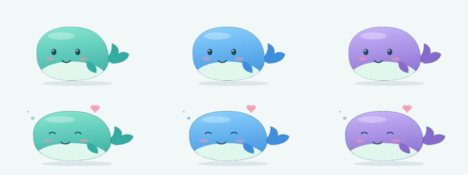

# BatteryPet

A Windows peripheral battery monitor with pixel-style tray icons, an interactive desktop pet, custom images and sounds, and AI agent-assisted device adaptation.

[简体中文](README.zh-CN.md) · [Changelog](CHANGELOG.md) · [Adaptation guide](docs/DEVICE_ADAPTATION.zh-CN.md) · [Third-party notices](THIRD_PARTY_NOTICES.md)

**Version 0.4.1 · Preview**

> Publication preparation: the redistribution license of the existing third-party HID transport has not been confirmed. MIT does not relicense that file or third-party artwork. See [third-party notices](THIRD_PARTY_NOTICES.md) before publishing a build.



## Features

- Large pixel battery digits with dark outlines and battery-dependent colors; ring and battery styles. Left-click a device tray icon to refresh.
- An interactive whale with breathing, blinking, touch and drag feedback. Click the pet to show a temporary battery bubble; dragging stays inside the screen work area.
- 60–180% scale, three colors, optional animation and always-on-top behavior. Import PNG, JPG, GIF or BMP pets.
- Optional WAV/MP3 click sounds with preview and restore defaults; disabled initially.
- Per-device low-battery thresholds and duplicate suppression. Failed reads retain clearly marked old values instead of showing zero.
- Optional Windows sign-in startup and independent tray-only silent startup.
- Local vendor-program analysis, agent workspace task export, and declarative adapter import with read-only verification.

## Supported hardware

| Device | Connection | Status |
| --- | --- | --- |
| Logitech G502 X LIGHTSPEED with `046D:C547` receiver | 2.4 GHz | Battery percentage read successfully on real hardware |
| Other Logitech models/receivers | 2.4 GHz | Not verified |
| Declarative HID Feature/Input adapters | Vendor HID interface | Experimental; local verification required |
| Bluetooth devices | Bluetooth | Not implemented |

The Logitech provider queries slots 1 and 2 using HID++ Unified Battery (`0x1004`). This is not universal Logitech support. Sleep, reconnect, charging and driver coexistence need broader real-hardware testing.

## Requirements and installation

- Windows 10/11 x64.
- **.NET 8 Desktop Runtime** and **Python 3.10+**, registered with Windows or available as `python` on PATH.
- No third-party Python packages required.

Once a release is published, download the Windows ZIP from [Releases](https://github.com/sadwind227/BatteryPet/releases), extract the entire folder, and run `BatteryPet.exe`. This is a framework-dependent package, not a standalone executable: keep its scripts and configuration files beside it. Do not run from inside the ZIP.

Closing the panel keeps the app running. Quit through the tray menu. Silent startup shows only tray icons; show the pet again from the tray menu.

## Device adaptation

1. Open **设备适配 / Device adaptation** and select a vendor program or resource directory. Selecting an EXE does not execute it.
2. Analyze local script/ASAR evidence, choose the target VID/PID, agent and workspace, then export a task folder.
3. Review the evidence and run the generated command or send the workspace instruction.
4. Import `candidate.json`, perform read-only trial reads, and compare two different real battery levels before enabling it.

Codex, Claude Code, DeepSeek Harness and Hermes have CLI templates. WorkBuddy and other desktop agents use workspace instructions. Install and authenticate the chosen agent separately; running it may consume its quota.

Imported adapters only support vendor HID Feature reads without preparation commands and passive Input reports. Encrypted protocols, handshakes and unknown writes remain unsupported. Agent output alone does not prove hardware compatibility. [Detailed guide](docs/DEVICE_ADAPTATION.zh-CN.md).

## Build and verify

With the .NET 8 SDK and Python installed, run from the repository root:

```powershell
dotnet build -c Release
python -m unittest test_provider.py test_adaptation.py -v
dotnet publish -c Release --no-self-contained -o artifacts/app
```

Optional checks:

```powershell
.\artifacts\app\BatteryPet.exe --ui-check
.\artifacts\app\BatteryPet.exe --adapt-check
.\artifacts\app\BatteryPet.exe --icon-check
```

`--demo` uses labeled simulated data and separate settings. Checks write reports and preview images beside the executable. Version 0.4.1 passed **23 Python tests** and **44 application interaction/rendering checks**; no real model calls or actual startup-entry changes are made by those checks. They do not replace a hardware test matrix. [Testing notes](docs/TESTING.zh-CN.md).

## Data and privacy

Settings, assets, last-read diagnostics and adapter verification records live under `%LOCALAPPDATA%\BatteryPet`. Normal battery monitoring does not use an online service. Exporting a task creates a new child folder in the selected workspace. Review its evidence before running an external agent: the configured agent service may receive task contents and create its own logs or sessions.

## License and references

Original BatteryPet code uses [MIT](LICENSE), with explicitly listed [third-party exceptions and pending permissions](THIRD_PARTY_NOTICES.md). The optional Coopanion image retains its upstream license and attribution. No restricted DeepSeek Balance Whale Widget artwork or sounds are bundled.

References: [EZ2.4G](https://github.com/Ap0LoG1zE/EZ2.4G), [INCOTT Driver](https://github.com/oexi/incott-driver-desktop), [FerrisPulse](https://github.com/Ferris-echo/FerrisPulse), [DeepSeek Balance Whale Widget](https://github.com/MeteorNOX/DeepSeek-Balance-Whale-Widget), [Coopanion](https://github.com/Pal-AI-Lab/Coopanion). References do not imply affiliation or universal device support.
