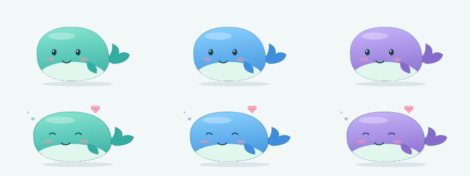
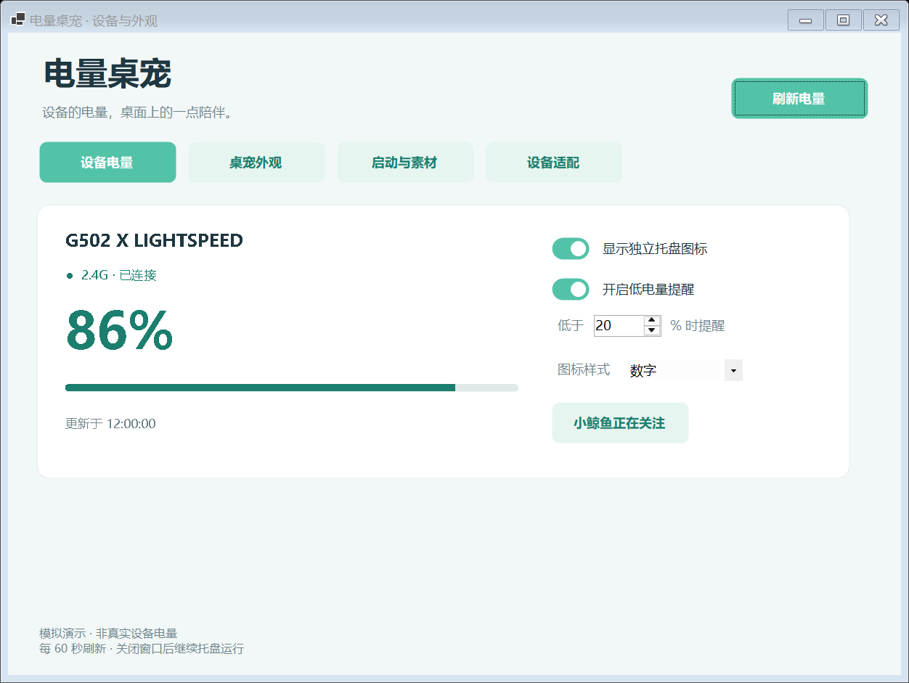
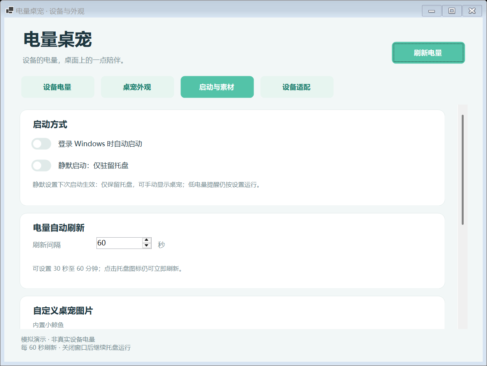

<div align="center">

# BatteryPet · 电量桌宠

**外设电量随时可见，桌面多一点陪伴。**

Windows 电量托盘 · 互动桌宠 · Agent 辅助设备适配

[English](README.md) · [下载程序](https://github.com/sadwind227/BatteryPet/releases) · [版本记录](CHANGELOG.md) · [详细操作](docs/USER_GUIDE.zh-CN.md)

**v0.7.0-dev · 预览版 · Windows x64 · MIT 许可**



</div>

BatteryPet 把支持的外设电量显示成清晰的像素托盘图标。点击桌宠才弹出电量气泡，也可以只保留托盘，安静运行。

## 下载与启动

### 三种文件怎么选？

**日常使用推荐 EXE 安装包；想自行管理程序目录选便携 ZIP；只有查看或修改代码才需要源码 ZIP。三者不必全部下载。**

| 文件 | 适合谁 | 使用方式 |
| --- | --- | --- |
| `BatteryPet-v0.7.0-dev-Setup.exe` | 普通用户、从旧版升级的用户 | 安装向导中输入或浏览安装位置，完成后从开始菜单启动。后续升级会记住上次选择的位置。 |
| `BatteryPet-v0.7.0-dev-windows-x64-preview.zip` | 希望自行解压、移动或保留多个版本的用户 | 完整解压到可写目录，运行其中的 `BatteryPet.exe`；无需运行安装器。 |
| `BatteryPet-v0.7.0-dev-source.zip` | 开发者、想查看源码的用户 | 包含源码、构建脚本和文档，需要自行编译；不能解压后直接当成程序运行。 |

上面的文件名以本地准备的 v0.7.0-dev 为例，实际已发布版本和附件以 [Releases 页面](https://github.com/sadwind227/BatteryPet/releases)为准。GitHub 自动生成的 **Source code (zip/tar.gz)** 也是源码，不是便携程序包。

### 首次使用

1. 使用 **Windows 10/11 x64**，从 Releases 选择 **Setup.exe 或 windows-x64-preview.zip 其中一个**。
2. EXE 用户按向导选择安装位置；ZIP 用户完整解压后运行 `BatteryPet.exe`。
3. **无需安装 Python 或 .NET。**程序包自带所需 .NET 运行库；请保留 EXE 旁的全部 DLL、JSON 和子目录，不能只复制单个 EXE。

“便携”指程序无需安装；设置和素材仍保存在当前账户的 `%LOCALAPPDATA%\BatteryPet`，不会跟着 ZIP 目录自动移动到另一台电脑。自包含包体积较旧版更大。可选 agent 辅助流程仍需要用户自行安装并登录对应 agent；日常电量读取不需要 agent。

### 从旧版升级

- **使用 EXE：**先从托盘菜单退出旧版，运行新版安装包。向导默认填入上次安装根目录，也可以另选位置；新版安装到独立版本子目录，保留旧程序以便回退。安装前自动备份设置、素材、已启用适配和验证记录；已有开机启动命令和开始菜单入口会指向新版，原本未开启的自启动不会被自动开启。
- **使用 ZIP：**先退出旧版，将新版完整解压到新目录再运行。同一 Windows 账户的设置和适配继续使用；如已开启开机启动，在新版中关闭后再开启一次，以更新程序路径。

无需重新生成已保存的设备适配。数据备份位置、回退方法及兼容范围见 [安装与升级说明](docs/UPGRADE.zh-CN.md)。

## 功能一览

| 电量监测 | 桌宠互动 |
| --- | --- |
| 大号像素数字、圆环、电池托盘样式 | 左键点击才显示电量气泡 |
| 电量变色、每个设备独立提醒阈值 | 工作区边界限制、跨屏拖动 |
| **30–3600 秒**自定义自动刷新，默认 60 秒 | 60–180% 大小、三种配色、动画与置顶 |
| 左键点击设备托盘图标立即刷新 | 导入 PNG/JPG/GIF/BMP、可选 WAV/MP3 点击音效 |
| 读取失败标注旧值，避免冒充当前电量 | 可选 Windows 登录自启、仅托盘静默启动 |

刷新时间在 **「启动与素材 → 电量自动刷新」**设置，修改后立即生效并保存。关闭面板会继续运行；完全退出请使用托盘菜单。

<details>
<summary>查看设备面板（图中为明确标记的模拟数据）</summary>



</details>

<details>
<summary>查看自动刷新、启动和图片设置</summary>



</details>

## 支持哪些设备

| 设备 | 连接方式 | 当前状态 |
| --- | --- | --- |
| 罗技 G502 X LIGHTSPEED，接收器 `046D:C547` | 2.4G | 已实机读取百分比 |
| 其他罗技型号或接收器 | 2.4G | 尚未验证 |
| 用户导入的 Feature/Input 适配 | 厂商 HID 接口 | 实验性，需要本地对照验证 |
| BLE 标准电量服务 0x180F / 0x2A19 | 蓝牙 LE | 已实现，成功直读尚待实机对照 |
| Windows 提供的电量报告 | 蓝牙，含部分经典蓝牙设备 | 已取得系统报告，在线状态可能未知 |

内置采集查询接收器槽位 1、2 的 HID++ 统一电量特性 `0x1004`。鼠标休眠时可先唤醒再刷新；睡眠恢复、充电、拔插和厂商客户端共存仍需更多硬件测试。

Windows 配对后，蓝牙读数会自动采集，优先使用 BLE 直接读数。无法确认在线的 Windows 报告值会标灰，新设备默认仅列在面板中。蓝牙部分只需 .NET 和 Windows；2.4G/HID 与适配工具仍需 Python。[蓝牙范围和操作](docs/BLUETOOTH.zh-CN.md)。

## 扩展设备适配

「设备适配」页支持选择厂商程序资源、本地分析、导出 agent 任务和导入声明式候选。候选必须在两个不同真实电量下与可靠来源对照一致，才能启用。

Codex、Claude Code、DeepSeek Harness、Hermes 提供 CLI 模板；WorkBuddy 等桌面 agent 可以使用工作区指令。相应 agent 需自行安装和登录，其服务可能接收任务内容、消耗额度。

当前只支持无需准备命令的 Feature 读取和被动 Input 报告；复杂握手、加密协议仍需人工适配。[完整操作](docs/DEVICE_ADAPTATION.zh-CN.md)。

## 占用与数据保存

v0.4.2 在 20 个逻辑处理器的电脑上，短时受控采样得到：默认桌宠动画约占 **0.28% 整机 CPU、64 MiB 峰值工作集**；仅托盘空闲 CPU 低于采样分辨率，峰值工作集约 51 MiB。这些旧版空闲样本不含 v0.7.0-dev 蓝牙辅助进程的查询峰值；尚未量化 GPU 和成功硬件查询峰值。[测量条件与局限](docs/PERFORMANCE.zh-CN.md)。

日常电量监测不联网。设置、导入素材、最近读取诊断和适配验证记录存放在 `%LOCALAPPDATA%\BatteryPet`。运行外部 agent 前，请检查导出的证据内容。

## 源码构建与打包

需要 .NET 8 SDK 和 Python：

```powershell
dotnet build -c Release
python -m unittest test_provider.py test_adaptation.py
powershell -ExecutionPolicy Bypass -File scripts/package.ps1 -Version 0.5.0
```

打包脚本按审核过的文件清单生成程序 ZIP、源码 ZIP、SHA-256 校验值和文件清单，输出到 `artifacts/releases/v0.7.0-dev`，排除缓存、旧发布包和个人配置。

程序检查参数：`--ui-check`、`--adapt-check`、`--icon-check`。`--demo` 使用独立配置和明确标记的模拟值。[验证记录](docs/TESTING.zh-CN.md)。

## 许可与致谢

程序源码采用 [MIT](LICENSE)，详见[许可说明](docs/LICENSING.zh-CN.md)。.NET 启动器随附[原始许可证与第三方声明](licenses/dotnet/README.md)。可选示例角色图由维护者制作；维护者声明角色属于公有领域并确认持有公开分发权。[素材来源及随包范围](Examples/CustomPet/SOURCE.md)单独记录，图片不会自动改授 MIT。

默认鲸鱼、托盘图形和点击音由 BatteryPet 代码生成。FerrisPulse、EZ2.4G、INCOTT Driver、DeepSeek Balance Whale Widget、Coopanion 用于研究或交互参考，未将其应用源码和美术素材打入本版。[第三方声明](THIRD_PARTY_NOTICES.md) · [文件与权利检查](docs/COPYRIGHT_AUDIT.zh-CN.md)。

反馈问题时，请提供设备型号、接收器 VID/PID、连接方式和完整错误。分享诊断前删除设备序列号和个人路径。

开发状态：未使用的第三方解析器已移出本版，不包含新增雷柏支持。

